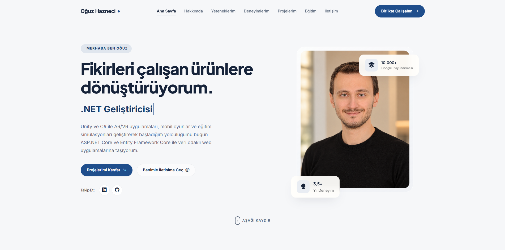
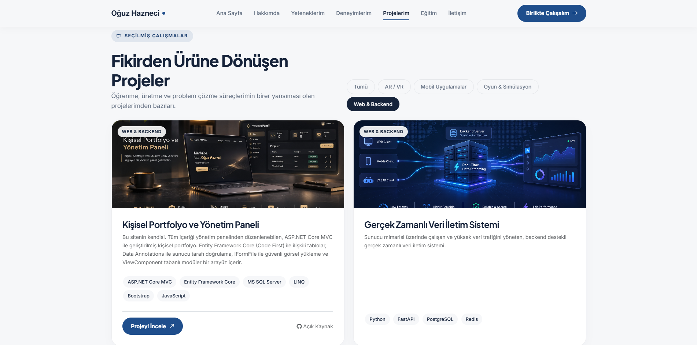
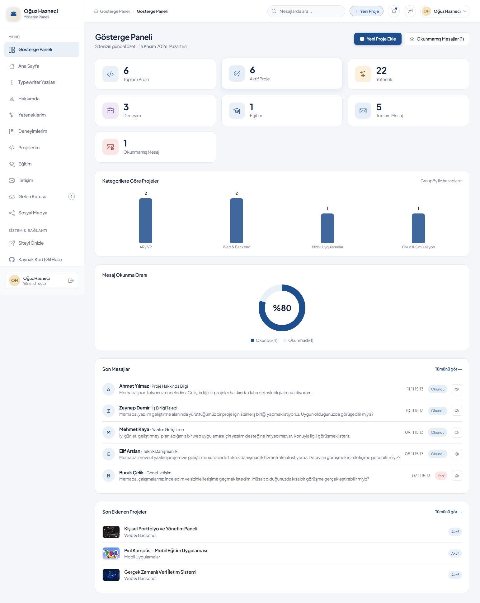
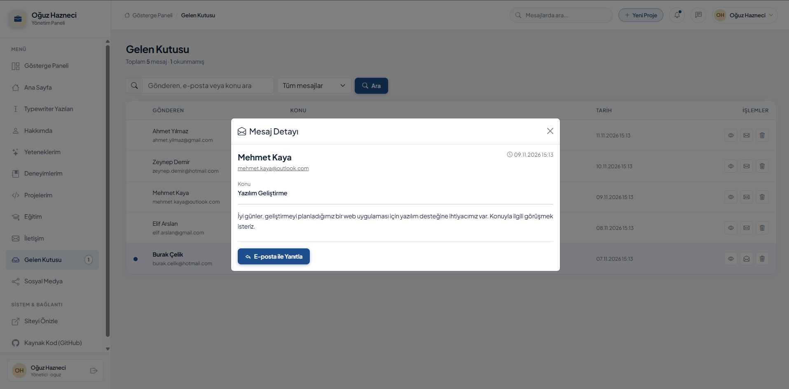
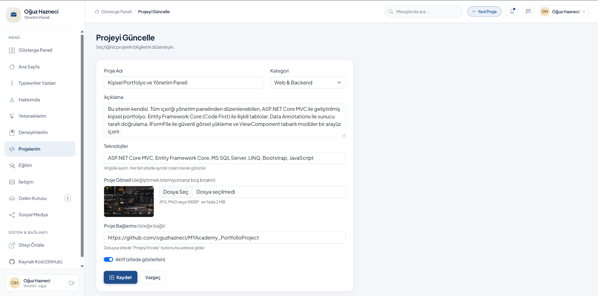
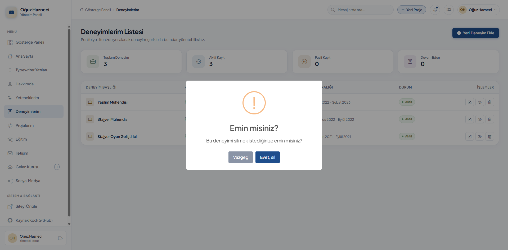

# Kişisel Portfolyo ve Yönetim Paneli

ASP.NET Core MVC ile geliştirilmiş, tüm içeriği bir yönetim panelinden düzenlenebilen kişisel portfolyo sitesi. Ziyaretçiler hakkımda, yetenekler, deneyimler, eğitim ve projeleri görüntüleyip iletişim formundan mesaj gönderebilir; site sahibi ise giriş yaptığı panelden bütün bu içeriği yönetir, gelen mesajları okur ve bir gösterge panelinden özet bilgileri takip eder.

> MY Academy 12. Dönem — Proje 1 (Portfolyo Case)

---

## İçindekiler

- [Ekran Görüntüleri](#ekran-görüntüleri)
- [Kullanılan Teknolojiler](#kullanılan-teknolojiler)
- [Kurulum ve Çalıştırma](#kurulum-ve-çalıştırma)
- [Yönetim Paneline Giriş](#yönetim-paneline-giriş)
- [Özellikler](#özellikler)
- [Proje Yapısı](#proje-yapısı)
- [Veritabanı](#veritabanı)
- [Güvenlik](#güvenlik)
- [Özgün Katkılar](#özgün-katkılar)
- [Bilinçli Tasarım Kararları](#bilinçli-tasarım-kararları)
- [Geliştirilebilecek Noktalar](#geliştirilebilecek-noktalar)

---

## Ekran Görüntüleri

| Ana sayfa | Projeler |
|---|---|
|  |  |

| Gösterge paneli | Gelen kutusu |
|---|---|
|  |  |

| Proje formu | Silme onayı |
|---|---|
|  |  |

---

## Kullanılan Teknolojiler

| Katman | Teknoloji |
|---|---|
| Çatı | ASP.NET Core MVC (.NET 10), Areas, ViewComponent, Partial View, Tag Helper |
| Veri erişimi | Entity Framework Core 10 (Code First, Migrations), LINQ |
| Veritabanı | MS SQL Server (LocalDB) |
| Kimlik doğrulama | Cookie Authentication |
| Arayüz | Bootstrap 5.3, Bootstrap Icons, Vanilla JavaScript (fetch API) |
| Bildirimler | SweetAlert2 |

Ek bir NuGet paketi kullanılmadı; kimlik doğrulama, hız sınırlama ve CSRF koruması ASP.NET Core'un yerleşik özellikleriyle yapıldı.

---

## Kurulum ve Çalıştırma

### Gereksinimler

- Visual Studio 2026 (ASP.NET ve web geliştirme iş yükü ile)
- .NET 10 SDK
- SQL Server LocalDB (Visual Studio ile birlikte kurulur)

### Adımlar

1. Repoyu klonlayın:
   ```bash
   git clone https://github.com/oguzhazneci/MYAcademy_PortfolioProject.git
   ```
2. `MYAcademy_PortfolioProject.slnx` dosyasını Visual Studio ile açın.
3. **F5** ile çalıştırın.

Bu kadar. Uygulama geliştirme ortamında açılırken:

- `PortfolioDayDb` veritabanı yoksa oluşturulur ve bütün migration'lar uygulanır,
- veritabanı boşsa `Data/seed-data.json` dosyasındaki içerik (hakkımda, yetenekler, deneyimler, projeler vb.) ve birkaç demo mesaj otomatik olarak eklenir.

Proje görselleri `wwwroot/uploads` klasöründe repoyla birlikte gelir; ayrıca bir şey yüklemeniz gerekmez.

> Veritabanını elle kurmak isterseniz: **Package Manager Console** → `Update-Database`. Başlangıç verisi bu komutla da eklenir.

---

## Yönetim Paneline Giriş

Panel adresi: **`/Admin`**

Geliştirme ortamı için demo hesap (`appsettings.Development.json`):

| Kullanıcı adı | Şifre |
|---|---|
| `admin` | `Demo123!` |

### Kendi şifrenizi tanımlamak

Gerçek giriş bilgileri repoya **girmez**; **User Secrets** ile saklanır. Visual Studio'da projeye sağ tıklayın → **Manage User Secrets** → açılan `secrets.json` dosyasına yazın:

```json
{
  "AdminCredentials": {
    "UserName": "kullanici-adiniz",
    "Password": "guclu-bir-sifre"
  }
}
```

User Secrets, `appsettings.Development.json`'daki değerleri ezer; tanımladıktan sonra demo şifresi sizin bilgisayarınızda çalışmaz.

Canlı ortamda (Production) ne `appsettings.Development.json` ne de User Secrets okunur. Bilgiler ortam değişkenleriyle verilmelidir (`AdminCredentials__UserName`, `AdminCredentials__Password`). Tanımlanmazlarsa sistem **kapalı kalır**: kimse giriş yapamaz.

---

## Özellikler

### Herkese açık site

| Bölüm | İçerik |
|---|---|
| Karşılama (Hero) | Selamlama, başlık, profil fotoğrafı, dönen "typewriter" unvanlar, sosyal medya bağlantıları |
| Hakkımda | Paragraflara bölünen tanıtım metni, fotoğraf, 3 istatistik, isteğe bağlı CV bağlantısı |
| Yetenekler | Kategorilere ayrılmış yetenekler ve animasyonlu seviye çubukları |
| Deneyimler | Tarih aralığıyla ("Eylül 2022 – Devam ediyor") sıralı iş deneyimleri |
| Eğitim | Okul, bölüm, yıllar ve otomatik "Mezun / Devam Ediyor" durumu |
| Projeler | Görselli proje kartları, kategoriye göre filtreleme, teknoloji etiketleri, proje bağlantısı |
| İletişim | İletişim bilgileri ve sunucu tarafında doğrulanan mesaj formu |

Sadece **aktif** işaretlenen kayıtlar sitede gösterilir; içerik silinmeden geçici olarak gizlenebilir.

### Yönetim paneli

| Modül | İşlemler |
|---|---|
| Gösterge Paneli | 7 istatistik kartı, kategori bazında proje dağılımı, okunma oranı, son 5 mesaj, son 3 proje, hızlı erişim |
| Ana Sayfa (Hero) | Tek kayıt düzenleme, profil fotoğrafı yükleme |
| Typewriter Yazıları | Ekleme, güncelleme, silme, sıralama, aktif/pasif |
| Hakkımda | Tek kayıt düzenleme, fotoğraf yükleme |
| Yetenekler | Kategori ve yetenek yönetimi (bire-çok ilişki), seviye (0–100) |
| Deneyimler | CRUD, tarih doğrulaması, aktif/pasif |
| Projeler | CRUD, görsel yükleme, kategoriye göre filtre, sıralama, aktif/pasif |
| Proje Kategorileri | CRUD (içinde proje olan kategori silinemez) |
| Eğitim | CRUD, yıl doğrulaması, aktif/pasif |
| İletişim | Tek kayıt düzenleme |
| Gelen Kutusu | Arama, okundu/okunmamış filtresi, mesajı sayfa yenilenmeden modalda açma, okundu işaretleme, silme |
| Sosyal Medya | CRUD, ikon önizlemesi, sıralama, aktif/pasif |

Ortak arayüz davranışları:

- Silme işlemlerinde **SweetAlert2** onay penceresi (tek bir ortak script, `data-confirm` işaretiyle)
- Başarılı işlemlerde köşede kısa süreli bildirim, hatalarda kapatılana kadar duran uyarı (tek merkezden, layout üzerinden)
- Okunmamış mesaj sayısı sidebar rozetinde ve navbar'daki bildirim zilinde
- Sekme başlığı ve yol göstergesi (breadcrumb) her sayfada o sayfanın adını gösterir

---

## Proje Yapısı

```
MYAcademy_PortfolioProject/
├── Areas/Admin/
│   ├── Controllers/          # Panel controller'ları + AuthController (giriş/çıkış)
│   ├── ViewComponents/       # Sidebar, navbar, head, style, script bileşenleri
│   └── Views/
│       ├── <Modül>/          # Liste + Create/Update ekranları ve ortak _XxxForm partial'ları
│       └── Shared/           # Mesaj modalı, bildirim partial'ı, layout bileşenlerinin görünümleri
├── Context/                  # PortfolioContext (DbContext, başlangıç verisi bağlantısı)
├── Controllers/              # DefaultController (site + iletişim formu)
├── Data/                     # SeedData.cs + seed-data.json (başlangıç verisi)
├── Entities/                 # Veritabanı tabloları
├── Migrations/
├── Models/                   # ViewModel'ler (SendMessage, Dashboard, ProjectSection, Login) ve ayar sınıfları
├── Services/                 # ImageUploadService (doğrulama + kaydetme + silme)
├── ViewComponents/           # Sitenin her bölümü için bir ViewComponent
├── Views/                    # Site görünümleri ve bileşen görünümleri
└── wwwroot/
    ├── js/                   # admin-ui.js (onay + bildirim), admin-message-modal.js
    ├── images/
    └── uploads/              # Panelden yüklenen görseller (profile/, projects/)
```

---

## Veritabanı

Code First yaklaşımıyla, entity sınıflarından migration'lar üretilerek oluşturuldu.

| Tablo | Açıklama |
|---|---|
| `HeroSections`, `Abouts`, `Contacts` | Tek kayıtlık sayfa içerikleri |
| `HeroTitles` | Typewriter unvanları |
| `Skills` → `SkillItems` | Yetenek kategorisi ve yetenekleri (bire-çok) |
| `Categories` → `Projects` | Proje kategorisi ve projeleri (bire-çok) |
| `Experiences`, `Educations` | Deneyim ve eğitim kayıtları |
| `SocialMedias` | Sosyal medya bağlantıları |
| `Messages` | İletişim formundan gelen mesajlar |

Kullanılan LINQ / EF Core teknikleri: `Include` ve filtrelenmiş `Include`, `Where`, `OrderBy` / `OrderByDescending`, `Take`, `Count` / `Any`, `GroupBy`, `AsNoTracking`, `IQueryable` üzerinde koşullu sorgu birleştirme.

---

## Güvenlik

| Önlem | Uygulama |
|---|---|
| Kimlik doğrulama | Cookie Authentication; `HttpOnly` çerez, 8 saatlik kayan oturum süresi |
| Yetkilendirme | Admin rotasının tamamı tek yerden korunur (`RequireAuthorization`); yeni bir admin controller'ı korumasız kalamaz. Tek istisna giriş sayfası (`[AllowAnonymous]`). |
| Açık yönlendirme | Girişten sonra sadece site içi adreslere dönülür (`Url.IsLocalUrl` + `LocalRedirect`) |
| CSRF | Global `AutoValidateAntiforgeryToken` filtresi: GET dışındaki bütün istekler token ister. Veri değiştiren hiçbir işlem GET ile yapılmaz. fetch isteklerinde token başlıkla gönderilir. |
| Overposting | İletişim formu entity yerine ViewModel'e bağlanır; `IsRead`, `SendDate` gibi alanları ziyaretçi belirleyemez |
| XSS | Bütün kullanıcı içeriği Razor ile kodlanarak yazılır; sunucudan JavaScript'e veri `data-*` attribute'larıyla aktarılır |
| Dosya yükleme | Uzantı izin listesi, 2 MB sınırı, rastgele (Guid) dosya adları, eski dosyanın yeni kayıt başarılı olduktan sonra silinmesi |
| Gizli bilgiler | Gerçek şifre User Secrets'ta; repoda sadece demo şifresi var |

---

## Özgün Katkılar

### 1. İletişim formu spam koruması: honeypot

Forma insanların göremediği bir "tuzak" alan (`Website`) eklendi. Formları körlemesine dolduran spam botları bu alanı da doldurur; dolu gelen gönderimler kaydedilmez. Bota hata yerine başarı mesajı gösterilir (sessiz reddetme), olay loglanır.

Alan `display:none` yerine ekran dışına itilerek gizlendi (bazı botlar gizli alanları tanır); `tabindex="-1"`, `aria-hidden` ve `autocomplete="off"` ile klavye kullanıcıları, ekran okuyucular ve tarayıcının otomatik doldurma özelliği tarafından yanlışlıkla doldurulmaz. CAPTCHA'nın aksine gerçek ziyaretçiye hiçbir ek yük getirmez ve dış bir servise bağımlı değildir.

### 2. Hız sınırlama (rate limiting)

Honeypot'u atlatan botlara karşı ikinci katman: aynı IP adresinden iletişim formuna **10 dakikada en fazla 3 gönderim**. ASP.NET Core'un yerleşik rate limiter'ı (Fixed Window, IP başına ayrı sayaç) kullanıldı. Sınırı aşan ziyaretçi boş bir 429 sayfası yerine iletişim bölümüne anlaşılır bir mesajla yönlendirilir.

### 3. Otomatik kurulum ve başlangıç verisi

Projeyi indiren kişinin boş bir siteyle karşılaşmaması için EF Core 9+ ile gelen `UseSeeding` kullanıldı. İçerik C# koduna elle yazılmak yerine doğrudan veritabanından `FOR JSON` ile dışa aktarıldı (`Data/seed-data.json`); böylece kopyalama hatası riski ortadan kalktı. Seed idempotenttir: veritabanında içerik varsa hiçbir şey yapmaz. Kayıt ID'leri yeni veritabanında yeniden üretilir, ilişkiler nesne referanslarıyla kurulur.

---

## Bilinçli Tasarım Kararları

- **Proje kategorisi tablosunun adı `Category`.** PDF'teki `ProjectCategory` kavramına karşılık gelir; proje şablonuyla gelen ad korundu. Yetenek kategorileri ayrı bir tablodadır (`Skill`).
- **Tek kayıtlık içerikler (Hero, Hakkımda, İletişim) için liste/ekle/sil ekranı yok.** Bu sayfalar tek bir düzenleme formudur; kayıt yoksa oluşturulur, varsa güncellenir (upsert). İkinci bir "Hakkımda" kaydı oluşturmak anlamsız olduğu için arayüz buna izin vermez.
- **Alt kaydı olan kategori silinemez.** İçinde yetenek bulunan bir yetenek kategorisi ya da içinde proje bulunan bir proje kategorisi silinmek istendiğinde, veritabanının kayıtları sessizce silmesi (cascade delete) yerine kullanıcıya önce hangi kayıtları silmesi gerektiği söylenir.
- **Mesajlar panelden oluşturulamaz veya düzenlenemez.** Mesajlar ziyaretçilere aittir; panel sadece okur, okundu olarak işaretler ve siler.
- **Silmede onay sorulur, geri alınabilir işlemlerde sorulmaz.** Aktif/pasif, okundu/okunmamış ve çıkış gibi işlemler tek tıkla yapılır.
- **Ortak davranışlar sayfalara değil işaretlere bağlıdır.** Silme onayı ve mesaj modalı, sayfalardaki `data-*` attribute'larını okuyan tek bir script ile çalışır; yeni bir sayfa JavaScript yazmadan bu davranışları kullanabilir.

---

## Geliştirilebilecek Noktalar

**Güvenlik**
- Giriş sistemi için ASP.NET Core Identity veya en azından şifrenin hash'lenerek saklanması
- Başarısız giriş denemelerinden sonra hesabın geçici olarak kilitlenmesi (brute force koruması)
- Yüklenen dosyaların uzantı yerine içeriğinin de (dosya imzası / magic number) kontrol edilmesi
- Uygulama bir proxy veya CDN arkasında yayınlanırsa gerçek IP için `UseForwardedHeaders`

**Kullanıcı deneyimi**
- 400 (süresi dolmuş form) ve 404 için özel hata sayfaları
- Gelen Kutusu ve proje listesinde sayfalama
- Yüklenen görsellerin otomatik olarak yeniden boyutlandırılması / sıkıştırılması

**Altyapı**
- Bağlantı cümlesinin `OnConfiguring` yerine `appsettings.json` + `AddDbContext` ile yapılandırılması
- Hız sınırlama sayaçlarının birden fazla sunucuda ortak tutulması (ör. Redis) ve Sliding Window algoritması
- Görsel yükleme alanının ortak bir partial view'a taşınması (Hero, Hakkımda ve Proje formlarında tekrar ediyor)
- Birim ve entegrasyon testleri
